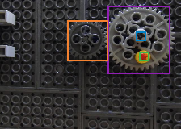

# hip-tile

**cuTile-style GPU kernels for AMD, written in pure Rust.** You write a kernel as operations on whole tiles. `rustc` compiles it straight to AMDGPU machine code, and `cargo` builds, embeds and launches it through HIP. There is no C++, no `hipcc` and no inline assembly.

To show it works on a real model, `hip_darknet` runs a Darknet YOLOv4-tiny detector on the GPU. It's a direct Rust port, using kernels written with hip-tile.

<p align="center">
  <br>
  <em>LegoGears YOLOv4-tiny on a Radeon 680M iGPU: 4.8 ms per frame, 92× faster than the CPU reference.</em>
</p>

## Contents

- [Highlights](#highlights)
- [A kernel](#a-kernel)
- [How it works](#how-it-works)
- [Requirements](#requirements)
- [Quick start](#quick-start)
- [Project layout](#project-layout)
- [The tile model](#the-tile-model)
- [hip_darknet](#hip_darknet)
- [Results](#results)
- [Testing](#testing)
- [Limitations and roadmap](#limitations-and-roadmap)
- [License](#license)

## Highlights

- **Pure Rust from kernel to launch.**
  - Device code is ordinary `#![no_std]` Rust, built for `amdgcn-amd-amdhsa` by a pinned nightly `rustc`.
  - The host side uses hand-written HIP bindings.
  - A plain `cargo run` drives the whole pipeline.
- **Tile programming model.**
  - Kernels say *what* to compute on tiles: `load_tile`, `mma`, `map`, `store_tile`.
  - The library decides at compile time how each tile maps to threads, registers and LDS (shared memory).
- **Typed launches.** `#[kernel]` turns one Rust function into the GPU entry point and a typed host launcher, so mismatched kernel arguments are compile errors.
- **Fast enough to matter.**
  - The tile GEMM reaches 2.3 TFLOP/s on a 12-CU iGPU and beats rocBLAS at N=2048.
  - The YOLO detector runs at about 170 frames per second end to end.
- **Checked.** 30 GPU tests compare every kernel and every network layer with CPU references and with dataset ground truth.

## A kernel

This is the complete GEMM kernel (`kernels/src/gemm.rs`):

```rust
use hip_tile::prelude::*;
use hip_tile_macros::kernel;

pub const BM: usize = 128;
pub const BN: usize = 128;
pub const BK: usize = 16;

#[kernel(lds = mma_lds_bytes::<f32>(BM, BN, BK))]
fn gemm(a: Tensor<f32>, b: Tensor<f32>, c: TensorMut<f32>) {
    let (bi, bj) = block_id();
    let (r0, c0) = (bi * BM as u32, bj * BN as u32);
    let mut acc = Tile::<f32, BM, BN>::zeros();
    let mut k = 0;
    while k < a.cols() {
        let ta = a.load_tile::<BM, BK>(r0, k);
        let tb = b.load_tile::<BK, BN>(k, c0);
        acc = mma(&ta, &tb, acc);
        k += BK as u32;
    }
    c.store_tile(r0, c0, &acc);
}
```

And this launches it from the host:

```rust
use kernels::gemm::{BM, BN, gemm};

let grid = (n.div_ceil(BN as u32), m.div_ceil(BM as u32));
gemm::launch(&module, None, grid, a.tensor(m, k), b.tensor(k, n), c.tensor_mut(m, n))?;
```

Here `a`, `b` and `c` are `hip_rt::DeviceBuffer<f32>`, and `m`, `n`, `k` are `u32`.

`load_tile` and `store_tile` mask tile edges that fall outside the tensor, so odd sizes such as 1000×1000 or 130×77 need no special handling.

## How it works

```
 kernels/src/*.rs  (#[kernel] fns, tile ops)
        │
        │  build.rs → hip-tile-build → nested `cargo rustc`
        │    --target amdgcn-amd-amdhsa  -Ctarget-cpu=gfx1031  -Zbuild-std=core
        ▼
 rustc → LLVM → AMDGCN machine code (.elf code object)
        │
        │  include_bytes!  (embedded in the host binary)
        ▼
 host binary ── hip-rt ── hipModuleLoadData / hipModuleLaunchKernel ── libamdhip64.so ──▶ GPU
```

- `#[kernel]` emits two items from the same signature.
  - On the device, it emits an `extern "gpu-kernel"` entry point.
  - On the host, it emits a `launch` function. That function packs the `#[repr(C)]` arguments, uses the 256-thread block size, and passes the LDS size the kernel declared.
- There is one non-Rust dependency at run time: AMD's HIP runtime library (`libamdhip64.so`). It plays the role that `libcuda.so` plays for CUDA.

## Requirements

- **Linux with ROCm** (tested: ROCm 10.1 on WSL2) and the HIP runtime plus headers for your GPU. On this machine that was:
  ```sh
  sudo apt install amdrocm-core-dev10.1-gfx1031 amdrocm-blas10.1-gfx1031 amdrocm-blas-dev10.1
  ```
  rocBLAS is used only as a GEMM reference in tests and benchmarks.
- **Rust nightly.** `rust-toolchain.toml` pins `nightly-2026-10-25` with `rust-src`, and `rustup` installs it automatically. Device code uses these unstable features: `abi_gpu_kernel`, `stdarch_amdgpu`, `gpu_launch_sized_workgroup_mem`, `core_intrinsics`, `abort_immediate`.
- **A supported AMD GPU.** The default target is `gfx1031`, an RDNA2 GPU that runs 32-thread waves. Override it with `HIP_TILE_ARCH=gfx1030` (for example). ROCm is expected at `/opt/rocm`; override it with `ROCM_PATH`.

## Quick start

```sh
# Kernel tests (GPU vs CPU and rocBLAS) and a GEMM benchmark
cargo test -p runner --release
cargo run  -p runner --release -- gemm --n 2048 --bench

# YOLO detection on the GPU, with an annotated output image
D=~/src/DarkSuite/datasets/LegoGears_v2
cargo run -p hip_darknet --release -- --gpu \
  --cfg $D/LegoGears_v2.cfg --weights $D/LegoGears_v2_last.weights --names $D/LegoGears.names \
  --out out.png $D/darkmark_image_cache/resize/00000082.png
```

```
predicted in 6.8 ms
medium gear: 100% (left_x:  133 top_y:    7 width:   77 height:   84)
small gear: 100% (left_x:   83 top_y:   25 width:   50 height:   50)
center: 85% (left_x:  168 top_y:   39 width:   12 height:   11)
pin: 75% (left_x:  172 top_y:   64 width:   12 height:   11)
```

On a machine with limited memory, cap builds at 4 jobs and a soft memory limit:

```sh
systemd-run --user --scope -q -p MemoryHigh=3G cargo build --release -j 4
```

## Project layout

| Path | Role |
|---|---|
| `crates/hip-tile` | The tile library used inside kernels: `Tile`, `Tensor` views, `load_tile`/`store_tile`, `map`, `mma`, `transpose`, `reduce`, LDS management. `no_std`; it builds for host and device. |
| `crates/hip-tile-macros` | `#[kernel]`: the device entry point plus a typed host launcher. |
| `crates/hip-tile-build` | `build.rs` helper: compiles the kernels crate for the GPU, embeds the ELF, sets the ROCm rpath. |
| `crates/hip-sys` | Raw FFI to the HIP runtime (and rocBLAS behind a feature), written by hand. |
| `crates/hip-rt` | Safe host API: `Device`, `Module`, `DeviceBuffer<T>`, `Stream`, `Event`, `Dim3`. |
| `kernels` | Kernels: `saxpy`, `copy`, `transpose`, `gemm`; YOLO ops `conv`, `maxpool`, `upsample`, `concat`. |
| `apps/runner` | Kernel tests, the GEMM benchmark (`gemm --bench`) and the conv benchmark (`conv-bench`). |
| `crates/hip_darknet` | Darknet YOLO in Rust: cfg/weights loader, CPU reference, YOLO decode with NMS, GPU executor, CLI. |
| `tasks/main` | Plan, progress, and lessons learned. |

## The tile model

- **Blocks.** Every kernel runs 256 threads per block (8 waves of 32). All threads of a block execute the same tile code, as in cuTile's block-level programs.
- **Tiles are register values.**
  - A `Tile<T, M, N>` is spread over the block's threads, which form a `TR × TC` grid.
  - `TC` is the largest power of two that is at most `256 / min(M, 16)` and that divides `N`; then `TR = 256 / TC`.
  - Thread `(ty, tx)` owns the elements `(ty + TR·i, tx + TC·j)`. Neighbouring threads therefore read neighbouring columns, which keeps global memory accesses contiguous (coalesced).
- **LDS (shared memory) is managed for you.**
  - `mma`, `transpose` and `reduce` stage data through the launch-sized LDS region.
  - Kernels declare how much they need with `#[kernel(lds = ...)]`, using helpers such as `mma_lds_bytes`. A launch with too little LDS traps instead of corrupting memory.
- **`mma` without matrix cores.** RDNA2 has no WMMA or MFMA units. `mma` stages both operands in padded LDS rows to avoid bank conflicts. Each thread then accumulates its block of C, up to 8×8, with FMA instructions.
- **Barriers are plain Rust** (`fence` + `s_barrier` + `fence`). Hand-written AMDGCN assembly is a project rule against, not a missing feature.

## hip_darknet

This is a direct port of Darknet's inference path. It never runs the Darknet binary: Darknet's C++ source was read to copy its behaviour exactly, and everything is checked with Rust tests.

- **Loading.** It reads `.cfg` files and `.weights` files (all header versions) and folds batch normalization into the conv weights, in f64 with Darknet's ε = 1e-5. It checks that the weights file is consumed exactly to the end.
- **Layers:** `convolutional` (leaky/linear), `maxpool` (Darknet padding rules), `route` (concat and `groups`/`group_id` slices), `upsample`, `yolo` (`scale_x_y`).
- **Decode.** It applies `greedynms`, which in Darknet means DIoU-NMS, at threshold 0.45.
- **GPU path.**
  - Convolution is an implicit GEMM on hip-tile: the im2col matrix is gathered on the fly with `Tile::from_fn`, and bias plus activation are applied in the same kernel.
  - Route group slices are zero-copy tensor views.
  - Weights are uploaded once. Each forward uses one stream and one synchronization.
- **CLI flags:** `--gpu`, `--out` (annotated image or directory), `--bench N`, `--thresh`, `--nms`. Build with `--no-default-features` for a CPU-only binary.

More detail: [`crates/hip_darknet/README.md`](crates/hip_darknet/README.md).

## Results

All numbers: Radeon 680M iGPU (gfx1031, 12 CUs, RDNA2), f32. The iGPU shares its power budget with the CPU, so the figures are best-of-N with the CPU idle.

| Benchmark | Result |
|---|---|
| Tile GEMM, N = 1024 | 2.05 TFLOP/s (rocBLAS 2.69, so 0.76×) |
| Tile GEMM, N = 2048 | **2.28 TFLOP/s** (rocBLAS 1.91, so **1.19×**) |
| Conv (implicit GEMM), real YOLO layers | 250–970 GFLOP/s (56×40 maps fastest, 7×5 maps slowest) |
| LegoGears YOLOv4-tiny 224×160, CPU forward (1 thread) | 443 ms/frame |
| LegoGears, GPU forward | **4.8 ms/frame (92×)** |
| LegoGears, GPU end to end (resize, upload, download, decode) | 5.8 ms/frame |

| Correctness check | Result |
|---|---|
| GPU vs CPU, every layer, 3 images | max relative error 1.7e-4 (all layers under 1e-3) |
| GPU vs CPU detections, 10 images | identical (count, class, IoU ≥ 0.99, confidence within 1e-3) |
| Detections vs dataset labels, 10 images, 38 objects, IoU 0.5 | recall 1.000, precision 1.000, 0 class errors |

## Testing

```sh
cargo test -p runner --release                        # 28 GPU kernel tests
cargo test -p hip_darknet --release -- --nocapture    # unit, ground-truth, per-layer and detection parity
cargo test -p hip_darknet --release --no-default-features   # CPU-only build
cargo clippy --workspace --all-targets
```

The model tests skip themselves, with a message, if the LegoGears dataset is not present.

## Limitations and roadmap

- **Nightly Rust only.** The GPU target and its intrinsics are unstable, so the toolchain is pinned.
- **Fixed block shape.**
  - Blocks are always 256 threads.
  - Tiles must fit the thread grid, and a tile holds at most 64 elements per thread. With f32, 128×128 is the largest accumulator tile.
- **f32 and f64 only.** No f16 or bf16 yet, and no packed math (`v_pk_fma_f16`, `v_dot2_f32_f16`).
- **No matrix cores.** WMMA (gfx11) and MFMA (CDNA) are not used, so RDNA3 and CDNA GPUs get the FMA path.
- **One architecture per build,** chosen with `HIP_TILE_ARCH`; there is no multi-architecture binary or runtime JIT.
- **Next steps:**
  - Split the K loop across blocks for the small 7×5 YOLO layers.
  - Let route outputs be written directly into concatenation buffers.
  - Per-layer conv tile tuning.
  - An f16 path.

## License

MIT OR Apache-2.0, as declared in the workspace `Cargo.toml`.
